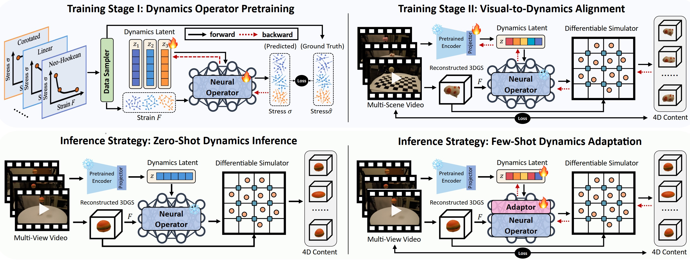

# NeuIDO: Neural Intrinsic Dynamics Operator for Physics-Informed 4D World Models

**Jiajing Lin, Xin Zhang, Jianhua Sun**

[Project Page](https://github.com/JiajingLin/NeuIDO) | [arXiv](https://arxiv.org/abs/2609.24313)



## Introduction

We propose NeuIDO, a world-dynamics modeling framework that learns a unified intrinsic-dynamics representation from visual observations. Formulated as a neural operator learning problem, NeuIDO uses a two-stage training strategy to map visual observations to intrinsic dynamics, enabling zero-shot inference from videos and few-shot adaptation to complex real-world scenes.

## TODO

We are preparing these contents and will release them as soon as possible.

- [ ] **Stage I data generation pipeline:** Document and release the MPM data-generation scripts for material trajectories.
- [ ] **Environment setup:** Document tested dependencies, versions, and installation steps.
- [ ] **Trained model weights:** Upload checkpoints and add download links and usage notes.
- [ ] **Executable README:** Add and verify end-to-end data preparation, training, and inference commands.
- [ ] **Branch network architecture:** Add the final diagram and implementation details.

## Citation

```bibtex
@inproceedings{lin2026neuido,
  title={NeuIDO: Neural Intrinsic Dynamics Operator for Physics-Informed 4D World Models},
  author={Lin, Jiajing and Zhang, Xin and Sun, Jianhua},
  booktitle={European Conference on Computer Vision},
  pages={480--498},
  year={2026},
  organization={Springer}
}
```
